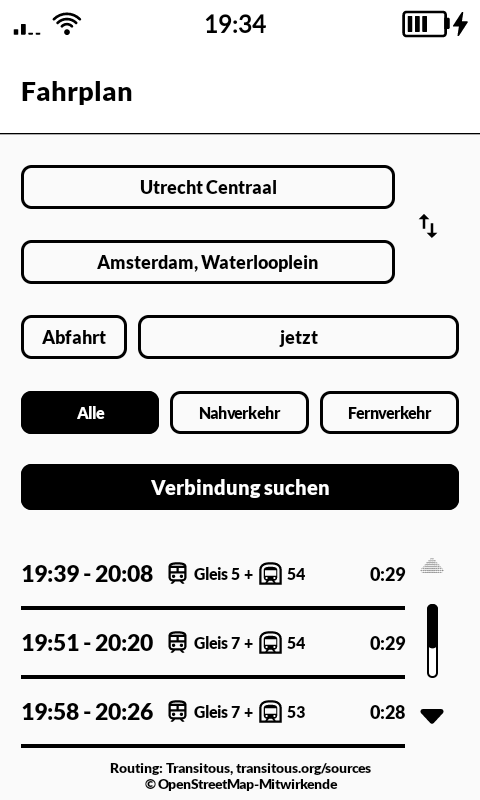
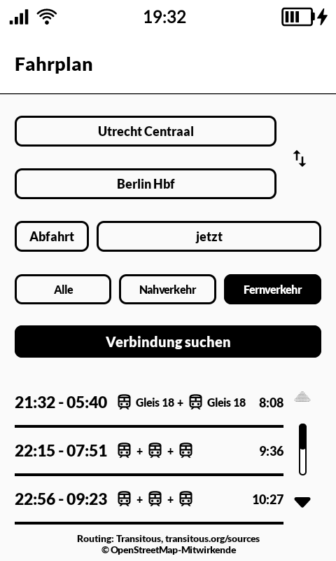
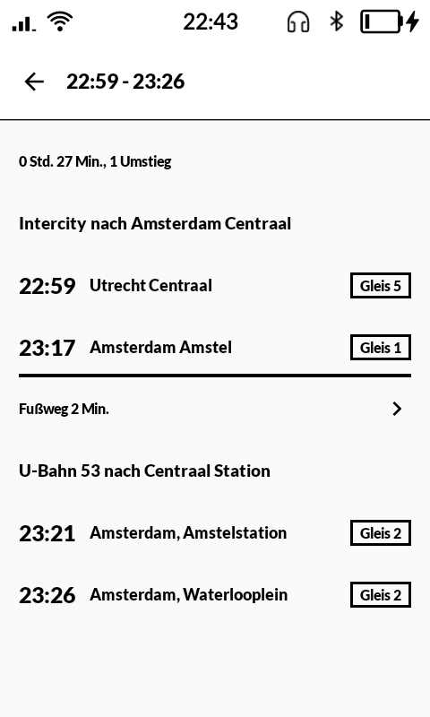
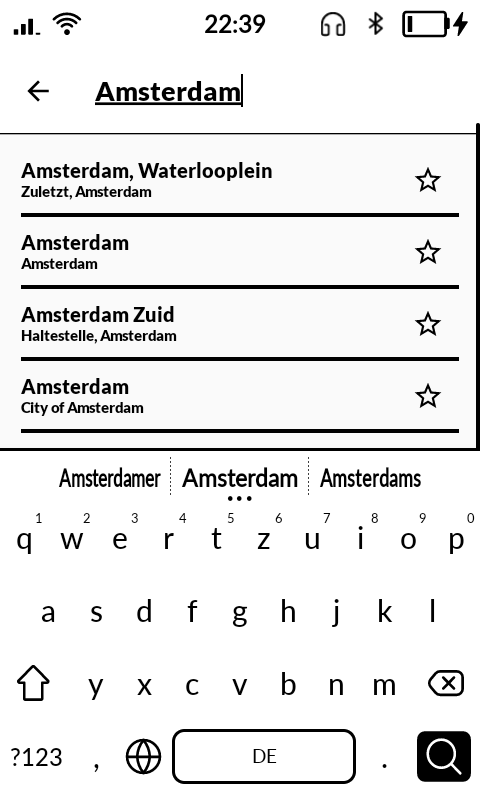

# 乗り換え norikae — Transit

Door-to-door public transit planner for the Mudita Kompakt (e-ink), built with the Mudita Mindful Design (MMD) framework. Search stops or addresses, plan by departure or arrival time, and open a trip for a calm leg-by-leg overview with platform info. Tapping a walk leg opens a black-and-white map with the route, your GPS position, and step-by-step directions. No API key or account required. The app is available in English and German.

The search can be narrowed to **local transport** (regional and suburban trains, subway, tram, bus, ferry) or to **long-distance** (high-speed, intercity and night trains, long-distance coaches, flights). This uses MOTIS's `transitModes` filter, so it changes what Transitous plans, not just what is shown afterwards; the choice is remembered on the phone.

*Norikae* is 乗り換え — the change from one line to the next, which is what a journey through a transit network is made of.

A fork of [MonoTransit](https://github.com/berendsliedrecht/MonoTransit) by Berend Sliedrecht, renamed, given its own icon, and translated into German. The routing, the screens and the map are his work; this repository keeps the same MIT licence and credits below.

Routing and geocoding are provided by [Transitous](https://transitous.org), a free, community-run service powered by [MOTIS](https://github.com/motis-project/motis). The walk map is rendered with [MapLibre](https://maplibre.org) from [OpenFreeMap](https://openfreemap.org) tiles (OpenStreetMap data); tile requests go to tiles.openfreemap.org. Your GPS position never leaves the device.

| | |
|---|---|
|  |  |
|  |  |

## Install

Download <https://github.com/baud-9600/norikae/releases/latest/download/norikae.apk> and sideload it.
That address always points at the newest release, and every release publishes a `.sha256`
beside the APK if you would rather check than trust.

To build and install it yourself:

```
./gradlew installRelease
```

The release APK is signed with the maintainer's own key, so it can be installed over an earlier build.

## Name and language

- *Norikae* (乗り換え) is Japanese for a transfer, the change from one train, tram or bus to the next. The app is a fork of MonoTransit, so the Japanese name follows the house convention of the other apps here.
- English is the default resource set; German is in `app/src/main/res/values-de/`. Android picks German when the phone is set to German.

## Structure

- `api/TransitousApi.kt`: Transitous (MOTIS) client: geocoding of stops/addresses and door-to-door planning
- `TransitViewModel.kt`: app state, planning calls, persisted favorites, recent places and the local/long-distance filter
- `ui/PlannerScreen.kt`: from/to/departure-time form and the compact results list
- `ui/Labels.kt`: localized line names and day labels built from the string resources
- `ui/TripDetailScreen.kt`: leg-by-leg trip overview with track chips
- `ui/WalkScreen.kt`: walk map (MapLibre, monochrome style) with GPS position
- `ui/WalkRoute.kt`: turn computation from the leg geometry (street grouping, bearings, distances)
- `ui/SearchPicker.kt`: shared search list with favorites (star) and recents (long-press to remove)

## Transitous usage policy

This app follows the [Transitous API guidelines](https://transitous.org/api/):

- Open source under the [MIT license](LICENSE), non-commercial, and resource-light (a single request per user action, no polling or scraping).
- Every request carries a `User-Agent` identifying the app, its version, this repository and a contact address (mk@asdfghasdfgh.de).
- Only the public endpoint `https://api.transitous.org/api/` is used.

## Data attribution

- Routing and geocoding: [Transitous](https://transitous.org), aggregating the transit feeds listed at [transitous.org/sources](https://transitous.org/sources/) (also linked in the app footer). All data remains subject to the licenses of those sources.
- Map and address data: © [OpenStreetMap](https://www.openstreetmap.org/copyright) contributors, licensed under the [ODbL](https://opendatacommons.org/licenses/odbl/).

## Support

The original app is [MonoTransit](https://github.com/berendsliedrecht/MonoTransit). If you find it useful, consider [sponsoring its author](https://github.com/sponsors/berendsliedrecht).

## License

[MIT](LICENSE)
